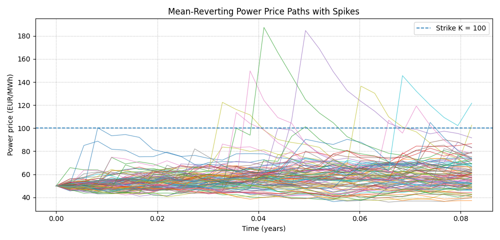

# Optimal Importance Sampling for Energy Derivatives

A quantitative simulation project on **rare-event pricing and variance reduction in electricity markets**.

The project builds on an EPFL **MATH-414 Stochastic Simulation** assignment, where crude Monte Carlo, fixed/adaptive importance sampling, and PDE-based optimal control were implemented for European and barrier options. That work now serves mainly as the theoretical and software foundation for the main extension: a stylized electricity cap under mean-reverting and jump-diffusion price dynamics.

## Energy-market motivation

<p align="center">
    
</p>
<p align="center">
  <em>Figure 1: Mean-reverting electricity price paths with temporary price spikes.</em>
</p>

Electricity prices have several features that make standard equity-style models (standard geometric Brownian motion) inadequate:

- **Mean reversion:** prices tend to move back toward seasonal or fundamental levels after temporary deviations.
- **Seasonality:** demand, weather, renewable generation, and system conditions vary systematically over time.
- **Price spikes:** outages, scarcity, congestion, extreme weather, and fuel shocks can produce abrupt short-lived price jumps.
- **Stochastic volatility:** uncertainty itself varies strongly across hours, seasons, and stressed system conditions. This is relevant for industrial scenario generation and risk management, but is left as future work here.

The baseline model is

$$
dX_t = \kappa\bigl(\mu(t)-X_t\bigr)dt + \sigma dW_t,
$$

with

$$
S_t=e^{X_t}.
$$

The cap-style payoff is accumulated over delivery periods,

$$
Y = q \sum_i e^{-rt_i} \left(S_{t_i}-K\right)^+ \Delta t.
$$

This creates a natural rare-event problem when the strike is high.

## Diffusion-only results

Under the seasonal mean-reverting diffusion model:

- crude Monte Carlo produces a positive payoff in only about **0.05%** of paths;
- the cap value is on the order of $1.5\times10^{-5}$;
- most simulated paths contribute nothing to the estimator.

A constant Brownian IS control $\theta$ changes the dynamics to

$$
dX_t^\theta = \left[ \kappa\bigl(\mu(t)-X_t^\theta\bigr) + \sigma\theta \right]dt + \sigma dW_t,
$$

with likelihood ratio

$$
L_T^\theta = \exp\left( -\theta W_T - \frac{1}{2}\theta^2T \right).
$$

Adaptive importance sampling minimizes the empirical second moment

$$
J(\theta) = \mathbb{E}_{Q_\theta} \left[ \left(Y^\theta L_T^\theta\right)^2 \right].
$$

Across independent seeds, the optimizer settles around

$$
\theta^* \approx 11.7\text{--}11.8.
$$

Typical results are:

- positive-payoff frequency under IS: **~49–50%**;
- cap-value estimate: **~$1.54\times10^{-5}$**;
- variance reduction: **several hundred times** relative to crude Monte Carlo.

So the Brownian tilt turns an event occurring roughly once every 2,000 crude paths into one occurring in about half of the tilted paths.

## Jump-diffusion extension

To model temporary electricity price spikes, the final stochastic extension uses

$$
X_t=Y_t+Z_t,
$$

with

$$
dY_t = \kappa\bigl(\mu(t)-Y_t\bigr)dt + \sigma dW_t,
$$

and

$$
dZ_t = -\kappa_J Z_t\,dt + dJ_t,
$$

where $J_t$ is a compound Poisson jump process.

The simulated paths show the intended behavior: most prices remain in the ordinary mean-reverting region, while a subset experience abrupt spikes that decay quickly.

With jumps, a $1{,}000{,}000$-path crude Monte Carlo run gives approximately:

- positive-payoff frequency: **11.4%**;
- cap-value estimate: **0.0237**;
- payoff standard deviation: **0.139**.

The existing IS method is deliberately left unchanged and continues to tilt only the Brownian component. This provides a robustness test.

The result is an important limitation: aggressive Brownian tilting becomes unstable once jumps materially contribute to tail events. Large $\theta$ values create severe likelihood-weight degeneracy, so the empirical second-moment objective can incorrectly favor extreme tilts and produce unreliable price estimates.

The main conclusion is therefore:

> Brownian importance sampling is highly effective when rare high-price events are generated by the diffusion, but is much less robust once an independent jump mechanism becomes an important source of tail risk.

## Results summary

| Price model | Estimator | Positive payoff paths | Price estimate | Main result |
|---|---:|---:|---:|---|
| Mean-reverting diffusion | Crude Monte Carlo | ~0.05% | ~$1.5\times10^{-5}$ | Strong rare-event problem |
| Mean-reverting diffusion | Adaptive Brownian IS | ~49–50% | ~$1.54\times10^{-5}$ | Several-hundred-fold variance reduction |
| Mean reversion + spikes | Crude Monte Carlo | ~11.4% | ~0.0237 | Spikes materially increase high-price exposure |
| Mean reversion + spikes | Brownian-only IS | unstable for aggressive tilts | unreliable at large $\theta$ | Jump-aware tilting is needed |

## EPFL foundation

The repository also contains the original theoretical benchmark problems used to develop and validate the architecture:

- **European call:** crude Monte Carlo → fixed IS → adaptive IS → PDE-based optimal control.
- **Up-and-out barrier call:** crude Monte Carlo → fixed-drift limitation → state-dependent optimal control.

These experiments provide the reusable implementation of simulation, payoffs, likelihood weighting, variance diagnostics, PDE solvers, and plotting used by the energy extension.

## Running the experiments

From the repository root:

```bash
python3 -m experiments.run_all vanilla
```

runs the European-call experiments,

```bash
python3 -m experiments.run_all barrier
```

runs the barrier-call experiments, and

```bash
python3 -m experiments.run_all all
```

runs both.

The energy experiments are run through their corresponding modules:

```bash
python3 -m experiments.crude_mc
python3 -m experiments.fixed_is
python3 -m experiments.adaptive_is
python3 -m experiments.jump_model
```

## Project structure

```text
optimal-importance-sampling/
├── README.md
├── requirements.txt
├── src/
│   ├── models.py
│   ├── payoffs.py
│   ├── pricing.py
│   ├── monte_carlo.py
│   ├── importance_sampling.py
│   ├── pde.py
│   ├── optimal_control.py
│   ├── statistics.py
│   └── plotting.py
└── experiments/
    ├── config.py
    ├── crude_mc.py
    ├── fixed_is.py
    ├── adaptive_is.py
    ├── optimal_control.py
    ├── jump_model.py
    └── run_all.py
```

## Future work

Natural extensions include:

- joint IS tilting of the **Brownian component, jump intensity, and jump-size distribution**;
- state-dependent control for jump models, potentially via an HJB/PIDE formulation;
- **Nord Pool calibration** of seasonality, mean reversion, diffusion volatility, jump frequency, jump sizes, and spike decay;
- stochastic volatility for more realistic industrial scenario generation and risk analysis.

## Origin

The numerical foundation comes from an EPFL **MATH-414 Stochastic Simulation** project and was rewritten into a modular Python codebase before being extended toward electricity and commodity-market applications.

## Keywords

**Keywords:** energy derivatives, electricity markets, power markets, Nordic power, Monte Carlo, importance sampling, adaptive importance sampling, rare-event simulation, variance reduction, mean reversion, seasonality, jump diffusion, price spikes, power caps, stochastic volatility, Girsanov theorem, optimal control, quantitative finance
